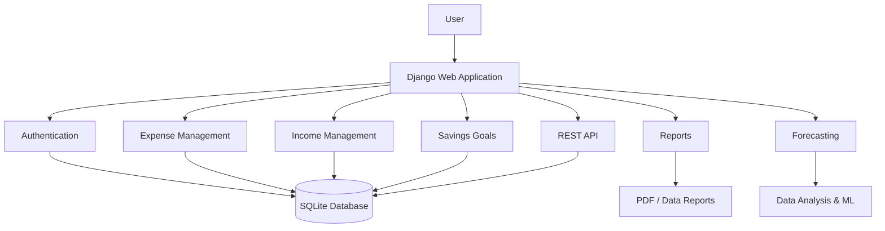

<!-- Animated project header -->
<div align="center">

<a href="https://github.com/SHARAT-S-UNNITHAN/EXPENSE_TRACKER_V2_BY_SHA">
  
</a>

<p><strong>A Django-based personal finance tracker with expense and income management, forecasting, savings goals, reports, and a REST API.</strong></p>

<p>
  
  
  
  
</p>

<p>
  <a href="https://github.com/SHARAT-S-UNNITHAN/EXPENSE_TRACKER_V2_BY_SHA/stargazers"></a>
  <a href="https://github.com/SHARAT-S-UNNITHAN/EXPENSE_TRACKER_V2_BY_SHA/network/members"></a>
  <a href="https://github.com/SHARAT-S-UNNITHAN/EXPENSE_TRACKER_V2_BY_SHA/issues"></a>
  
</p>

</div>

---

## ✨ About the project

**EXPENSE_TRACKER_V2_BY_SHA** is a web application designed to make everyday personal finance easier to understand. It brings expense records, income sources, spending limits, savings goals, and financial insights into one place.

The project combines a Django application with data-analysis and machine-learning libraries to explore spending patterns and generate useful financial forecasts.

## 🚀 Features

| Area | What it does |
|---|---|
| 🔐 Accounts | User registration, authentication, and account management |
| 💸 Expense tracking | Record, edit, categorize, and review personal expenses |
| 💰 Income tracking | Manage income entries and user-specific income sources |
| 📊 Financial insights | Review spending data and visual reports |
| 🔮 Expense forecasting | Explore expense prediction using machine-learning tools |
| 🎯 Savings goals | Set savings targets and track progress |
| 📄 Reports | Generate downloadable financial reports |
| 🔌 REST API | API endpoints for application data and prediction features |
| 🛡️ Security | Login-protected operations, owner-scoped data access, CSRF protection, and environment-based secrets |

> **Privacy by design:** expense, income, goal, and profile operations are designed to be scoped to the authenticated account. Do not use this project with real financial information until you have independently reviewed and configured the production deployment.

## 🧭 Application structure



## 🧰 Technology stack

- **Backend:** Python, Django
- **API:** Django REST Framework
- **Database:** SQLite (configurable through Django settings)
- **Data analysis:** Pandas, NumPy, Matplotlib
- **Machine learning:** scikit-learn
- **Reports and documents:** ReportLab, xhtml2pdf, openpyxl
- **Frontend assets:** HTML templates, CSS/JavaScript, Bootstrap

## ⚙️ Run locally

### 1. Clone the repository

```bash
git clone https://github.com/SHARAT-S-UNNITHAN/EXPENSE_TRACKER_V2_BY_SHA.git
cd EXPENSE_TRACKER_V2_BY_SHA
```

### 2. Create and activate a virtual environment

**Windows (PowerShell):**

```powershell
py -3.11 -m venv .venv
.\.venv\Scripts\Activate.ps1
```

**macOS / Linux:**

```bash
python3.11 -m venv .venv
source .venv/bin/activate
```

### 3. Install dependencies

```bash
python -m pip install --upgrade pip
pip install -r requirements.txt
```

### 4. Configure environment variables

Create a local `.env` file only if you use a dotenv loader, or set these variables in your shell / deployment platform. **The application settings read environment variables directly; a `.env` file is not automatically loaded by the current settings module.**

PowerShell example:

```powershell
$env:DJANGO_SECRET_KEY = "replace-with-a-new-long-random-secret"
$env:DJANGO_ALLOWED_HOSTS = "localhost,127.0.0.1"
$env:EMAIL_HOST_USER = "your-email@example.com"
$env:EMAIL_HOST_PASSWORD = "your-new-app-password"
```

Generate a fresh Django secret locally:

```bash
python -c "from django.core.management.utils import get_random_secret_key; print(get_random_secret_key())"
```

Never commit real credentials, app passwords, tokens, or production secrets.

### 5. Prepare the database

```bash
python manage.py migrate
```

### 6. Create an administrator (optional)

```bash
python manage.py createsuperuser
```

### 7. Start the development server

```bash
python manage.py runserver
```

Open [http://127.0.0.1:8000/](http://127.0.0.1:8000/) in your browser.

## 🔐 Production configuration

Before deploying, configure at least:

- `DJANGO_SECRET_KEY` — a newly generated, private Django secret.
- `DJANGO_ALLOWED_HOSTS` — comma-separated production hostnames.
- `EMAIL_HOST_USER` and `EMAIL_HOST_PASSWORD` — only if email delivery is enabled.
- `SECURE_HSTS_SECONDS`, `SECURE_HSTS_INCLUDE_SUBDOMAINS`, and `SECURE_HSTS_PRELOAD` — only after HTTPS is correctly configured and verified.

Also configure a production-grade database, HTTPS, backups, logging, and platform-specific environment variables. Review Django's deployment checklist before exposing the application publicly.

## 🧪 Quality checks

The repository's dependency/security workflow checks Python 3.11 and 3.13, runs dependency validation and vulnerability auditing, and performs Django checks and automated tests.

Run the application checks locally:

```bash
python manage.py check
python manage.py test
pip check
pip-audit
```

## 🗺️ Project modules

```text
EXPENSE_TRACKER_V2_BY_SHA/
├── api/                 # REST API and prediction endpoints
├── authentication/      # Registration and authentication
├── expenses/            # Expense records and limits
├── expense_forecast/    # Expense forecasting
├── goals/               # Savings goals
├── report_generation/   # Financial report generation
├── userincome/          # Income and income sources
├── userpreferences/     # User preferences
├── userprofile/         # Profile and source management
├── expensetracker/      # Django project configuration
├── templates/           # HTML templates
├── static/              # Static assets
├── requirements.txt
└── manage.py
```

## 🛣️ Roadmap

- [x] Core expense and income management
- [x] Savings goals and reporting modules
- [x] REST API and forecasting components
- [x] Application authorization and security hardening
- [x] Dependency/security workflow
- [ ] Complete Git-history credential purge and verify all affected refs
- [ ] Expand automated test coverage
- [ ] Production database and deployment hardening
- [ ] Add current application screenshots and a verified demo link

## 🤝 Contributing

Suggestions, bug reports, and improvements are welcome. Please open an issue before making major changes, and avoid including personal financial data or secrets in issues, screenshots, commits, or pull requests.

## 👨‍💻 Maintainer

**Sharat S Unnithan**

- GitHub: [@SHARAT-S-UNNITHAN](https://github.com/SHARAT-S-UNNITHAN)
- Portfolio: [sharat-s-unnithan.github.io/sharat-portfolio](https://sharat-s-unnithan.github.io/sharat-portfolio)

---

<div align="center">

<sub>Built with Python and Django · Focused on clearer, more thoughtful money management.</sub>

<br />


</div>
